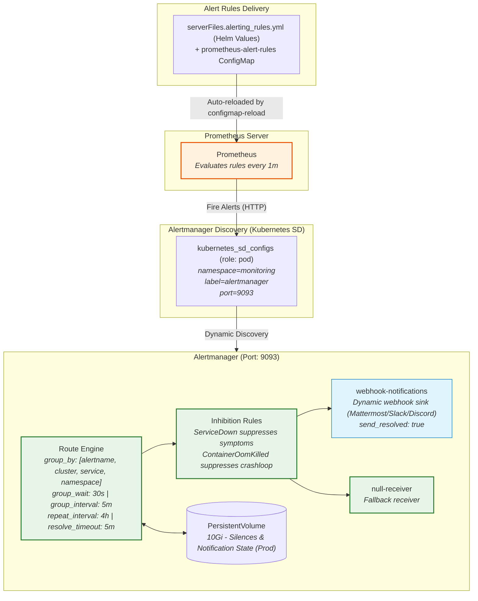

# ADR: Alertmanager Dispatch, Grouping & Notification

## Status
Accepted

## Context
Alertmanager is the centralized notification dispatcher for the production cluster, handling all alerts fired by Prometheus. It must perform intelligent deduplication, grouping, and silencing to prevent notification fatigue during cascading failures, and route resolved alerts for clear incident closure visibility.

---

## Architecture & Alert Flow

### 1. Alert Pipeline Diagram


---

## Decision

1. **Deployment:** Alertmanager is deployed as part of the **`prometheus-community/prometheus`** Helm chart (`alertmanager.enabled: true`) rather than as a standalone component, co-located with the Prometheus server in the `monitoring` namespace.

2. **Alertmanager Discovery (Kubernetes SD):**
   Prometheus uses **Kubernetes pod service discovery** to dynamically locate the Alertmanager endpoint without hardcoding pod IPs:
   ```yaml
   kubernetes_sd_configs:
     - role: pod
   relabel_configs:
     - source_labels: [__meta_kubernetes_namespace]
       regex: monitoring
     - source_labels: [__meta_kubernetes_pod_label_app_kubernetes_io_name]
       regex: alertmanager
     - source_labels: [__meta_kubernetes_pod_container_port_number]
       regex: "9093"
   ```

3. **Alert Rules Delivery (Chart-native `serverFiles` & ConfigMap Sync):**
   Alerting rules are maintained in two harmonized layers:
   - Primary: Chart-native `serverFiles.alerting_rules.yml` in Helm values files (`deployment/{env}/values-prometheus.yaml`), which are mounted into Prometheus and automatically reloaded by `configmap-reload`.
   - GitOps ConfigMap: Shared file [`deployment/common/alerts/prometheus-alerting-rules.yaml`](../deployment/common/alerts/prometheus-alerting-rules.yaml) synced via `task configmap:prometheus-alert` creating the `prometheus-alert-rules` ConfigMap.

4. **Grouping & Deduplication:**
   - **Group by:** `['alertname', 'cluster', 'service', 'namespace']` — ensures related alerts in the same scope are batched into a single notification.
   - **`group_wait: 30s`** — buffer time to collect all alert instances before sending the first notification.
   - **`group_interval: 5m`** — minimum time between follow-up notifications for the same group.
   - **`repeat_interval: 4h`** — suppression window for repeated notifications of the same ongoing alert.
   - **`resolve_timeout: 5m`** — time before an alert transitions to resolved if no longer firing.

5. **Notification Receiver & Webhook Dispatch:**
   - **Implemented:** Dynamic webhook receiver (`webhook-notifications`) with `send_resolved: true` targeting internal or external incident webhooks (Mattermost/Slack/Discord) injected via Kubernetes secrets (`alertmanager-secrets`).
   - Alerts with `severity: critical` and `severity: warning` route to `webhook-notifications` with fallback to `null-receiver` if disabled.

6. **Inhibition Rules (Alert Storm Suppression):**
   - **Root Cause Suppression:** When `ServiceDown`, `InstanceDown`, or `InstanceAbsent` fires, Alertmanager automatically inhibits cascading symptom alerts (`HighHttpErrorRate`, `HighHttpLatencyP99`, `PokemonApiHighErrorRate`, `PokemonApiHighLatency`, `HikariPoolStarvation`, `HighCpuUsage`) for that service.
   - **Container Failure Suppression:** When `ContainerOomKilled` fires, it inhibits generic `PodCrashLooping` alerts for the same pod.

7. **State Persistence:**
   - Production Alertmanager uses a **10Gi PersistentVolume** (`alertmanager.persistentVolume.enabled: true, size: 10Gi`) to durably store silence definitions and notification state across pod restarts.
   - Dev uses ephemeral in-memory storage suitable for local sandboxes.

---

## Implemented Alert Rules Catalog

| Alert Domain | Alert Name | Expression Summary | Severity | Purpose & Target |
| :--- | :--- | :--- | :--- | :--- |
| **App RED** | `InstanceAbsent` | `absent(up{service_name="spring-boot-app"})` | critical | Dead-man switch: pod absent or collector unreachable. |
| **App RED** | `InstanceDown` | `up{service_name="spring-boot-app"} == 0` | critical | Scrape failure on running pod. |
| **App RED** | `ServiceDown` | `absent(up{...}) or up{...} == 0` | critical | Overall service outage; root trigger for inhibition cascade. |
| **App RED** | `HighHttpErrorRate` | 5xx error rate > 5% over 5m | critical | General application HTTP SLA breach. |
| **App RED** | `HighHttpLatencyP99` | P99 latency > 2000ms over 5m | warning | High latency SLA breach; links to Tempo Exemplars. |
| **App RED** | `HttpTrafficSpike` | HTTP rate > 100 req/sec over 2m | warning | Abnormal traffic surge. |
| **App RED** | `HttpTrafficDrop` | Rate drops near 0 after active traffic | warning | Silent failure, ingress stall, or upstream network drop. |
| **Business RED**| `PokemonApiHighErrorRate` | Controller 5xx rate > 5% | critical | Core domain business API failure. |
| **Business RED**| `PokemonApiHighLatency` | Controller P99 latency > 2000ms | warning | Core domain business API degradation. |
| **Resource** | `HighCpuUsage` | Container CPU rate > 80% quota | warning | High CPU load on pod. |
| **JVM USE** | `JvmHeapUsageHigh` | Heap usage > 85% | critical | Immediate risk of OutOfMemoryError. |
| **JVM USE** | `JvmMetaspaceUsageHigh` | Metaspace > 90% | critical | Classloader leak or metaspace exhaustion. |
| **JVM USE** | `JvmHighGcOverhead` | GC pauses > 15% CPU time | warning | Excessive garbage collection latency. |
| **JVM USE** | `JvmThreadCountHigh` | Live threads > 250 | warning | Unbounded thread creation or leak. |
| **JVM USE** | `JvmThreadContention` | Blocked threads > 10 for 2m | warning | Monitor lock contention / thread deadlocks. |
| **Database** | `HikariPoolStarvation` | Pending connections > 0 for 1m | critical | Database pool exhaustion and caller thread blocking. |
| **Database** | `HikariConnectionTimeoutErrors` | `rate(connections_timeout_total) > 0` | critical | Timeouts acquiring connection from pool. |
| **Database** | `HikariConnectionAcquireLatencyHigh` | Acquire P99 > 250ms | warning | Slow database connection acquisition. |
| **CDC Stream** | `DebeziumDisconnected` | `debezium_connected == 0` | critical | CDC stream severed from MongoDB oplog. |
| **CDC Stream** | `DebeziumReplicationLagHigh` | Lag > 30000ms | warning | Change data capture falling behind source DB. |
| **CDC Stream** | `DebeziumQueueSaturated` | Remaining buffer < 10% | critical | Imminent event drop in CDC memory queue. |
| **K8s & Host** | `PodCrashLooping` | Restarts > 0 over 5m | critical | Repeated container crashing. |
| **K8s & Host** | `ContainerOomKilled` | OOMKilled == 1 | critical | Linux cgroup memory limit termination. |
| **K8s & Host** | `KubernetesCpuThrottlingHigh` | CFS throttled periods > 25% | warning | Severe CFS quota CPU throttling. |
| **Storage** | `PvcStoragePredictiveExhaustion` | Linear projection full in < 4h | critical | Automated predictive volume exhaustion warning. |
| **Host** | `HostDiskFillingFast` | Root filesystem free < 10% | critical | Node disk space nearly exhausted. |
| **RustFS S3** | `RustFsStorageErrorRateHigh` | RustFS S3 5xx errors > 5% | critical | S3 storage backend query/push failures. |
| **RustFS S3** | `RustFsDriveUnhealthy` | Drive unhealthy or nodes offline | critical | Hardware or node fault in RustFS distributed cluster. |

---

## Technical Specification & Implementation Mapping

| Key / Config Path | Value / Setting | Purpose | Environment |
| :--- | :--- | :--- | :--- |
| `alertmanager.enabled` | `true` | Deploy Alertmanager alongside Prometheus. | dev, prod |
| `alertmanager.persistentVolume` | `enabled: true, size: 10Gi` | Persist silence rules and notification state. | prod only |
| `config.alerting.alertmanagers` | Kubernetes SD (namespace=monitoring, port=9093) | Dynamic Alertmanager pod discovery. | dev, prod |
| `serverFiles.alerting_rules.yml` | Full 28-rule catalog + Loki + Tempo alerts | Primary rule delivery mechanism watched by configmap-reload. | dev, prod |
| `ConfigMap: prometheus-alert-rules` | `deployment/common/alerts/` | GitOps-managed common alert rules. | dev, prod |
| `route.group_by` | `['alertname', 'cluster', 'service', 'namespace']` | Deduplication and notification consolidation. | dev, prod |
| `route.group_wait` | `30s` | Buffer time before initial notification. | dev, prod |
| `route.group_interval` | `5m` | Minimum time between follow-up notifications. | dev, prod |
| `route.repeat_interval` | `4h` | Suppression window for ongoing alert re-notification. | dev, prod |
| `route.receiver` | `webhook-notifications` | Active webhook notification dispatcher. | dev, prod |
| `inhibit_rules` | ServiceDown/InstanceDown/OOMKilled suppression | Prevents cascading alert storms. | dev, prod |

---

## Consequences

- **Positive:**
  - Kubernetes SD ensures Alertmanager is always discovered dynamically, surviving pod rescheduling without config changes.
  - Comprehensive RED and USE alert catalog covers application, JVM, database, CDC, and host infrastructure.
  - Inhibition rules eliminate noise by silencing symptom alerts when root cause failure occurs.
  - All alerts link directly to the unified **Service Health & Alerting** dashboard in Grafana.
  - Webhook dispatch with secret reference enables zero-plaintext GitOps incident notification.
- **Negative:**
  - Highly dynamic environments require tuning prediction windows on `PvcStoragePredictiveExhaustion` to avoid false positives during burst data loads.
- **Risk:**
  - If the ConfigMap `prometheus-alert-rules` is deleted or malformed, Prometheus will load no alerting rules and fire no alerts until corrected.
