# ADR: RustFS S3-Compatible Distributed Object Storage Backend

## Status
Accepted (Supersedes [ADR: MinIO](./minio.md))

## Context
The observability stack (Grafana Loki, Tempo, Pyroscope, and Prometheus/Mimir) requires an S3-compatible object storage layer to decouple compute from persistence across both local developer sandboxes (Docker Desktop / KinD) and production on-premises/private cloud Kubernetes clusters.

Previously, MinIO served as the default S3 backend ([ADR: MinIO](./minio.md)). However, several technical and enterprise operational constraints necessitated evaluating modern alternatives (documented in [`notes/OBJECT_STORAGE_EVALUATION.md`](../notes/OBJECT_STORAGE_EVALUATION.md)):
1. **Licensing & Legal Constraints:** MinIO's transition to GNU AGPLv3 imposes copyleft restrictions and aggressive commercial licensing audits, creating compliance hurdles for enterprise deployments.
2. **Resource Footprint in Local Sandboxes:** MinIO's Go runtime and background scanners consume 250MB–1GB+ RAM per pod. On developer workstations with 8GB–16GB total host RAM, this leads to frequent OOM pressure when running concurrently with Spring Boot, Redpanda, MongoDB, and Alloy.
3. **Garbage Collection (GC) Jitter:** Under sustained burst telemetry (Loki chunk flushes and Tempo trace block uploads), Go runtime GC cycles introduce tail-latency (p99) I/O jitter.
4. **Alternative Evaluation (VaultS3 vs. RustFS):** While VaultS3 demonstrated an ultra-low memory footprint (~17MB), it carries the exact same AGPLv3 license as MinIO, multi-node clustering is officially in Beta, and it carries an unacceptable enterprise risk with a **bus factor of 1** (single primary maintainer).

RustFS (`rustfs/rustfs`) was selected as the unified successor across both development and production environments.

---

## Architecture & Storage Integration

### 1. RustFS Storage Topology Diagram
RustFS operates as the central object store backing all telemetry persistence engines in the LGTM stack, while also streaming its own operational telemetry directly into Grafana Alloy via OTLP:

```mermaid
flowchart TD
    subgraph ObservabilityConsumers ["LGTM Compute Consumers"]
        LOKI_W["Loki Ingesters (Write Path)"]
        LOKI_B["Loki Compactor (Retention/Deduplication)"]
        TEMPO_B["Tempo Block Builder"]
        TEMPO_Q["Tempo Querier (Parquet Byte-Range Reads)"]
        PYRO_W["Pyroscope Ingestion (Profiles)"]
        MIMIR_ING["Mimir Ingesters / Compactor"]
    end

    subgraph RustFSService ["RustFS Distributed Object Storage (Ports :9000 API / :9001 Console)"]
        RUSTFS_POD["RustFS Instance(s)<br/><i>Standalone (Dev: 128Mi Req / 512Mi Limit)<br/>Distributed EC (Prod: 4+ Nodes)</i>"]
        
        subgraph Buckets ["Automated Buckets"]
            B_LOKI[("bucket: 'loki'<br/><i>TSDB Chunks & Indexes</i>")]
            B_TEMPO[("bucket: 'tempo'<br/><i>Parquet Trace Blocks</i>")]
            B_PYRO[("bucket: 'pyroscope'<br/><i>Continuous Profiles</i>")]
            B_MIMIR[("bucket: 'mimir'<br/><i>Metric Blocks</i>")]
        end

        RUSTFS_POD --- B_LOKI
        RUSTFS_POD --- B_TEMPO
        RUSTFS_POD --- B_PYRO
        RUSTFS_POD --- B_MIMIR
    end

    subgraph StorageBacking ["Storage Infrastructure"]
        PV[("PersistentVolumeClaim(s)<br/><i>High-Performance SSD / NVMe</i><br/>MinIO xl.meta Compatible")]
    end

    subgraph CollectorIntegration ["Self-Observability"]
        ALLOY["Grafana Alloy (:4318 OTLP)"]
    end

    subgraph Management ["Identity & Administration"]
        ADMIN["Platform Engineer / SRE"]
        KEYCLOAK["Keycloak SSO (OIDC + PKCE S256)"]
    end

    %% Storage Binding
    RUSTFS_POD -->|"Direct NVMe/SSD Mount"| PV

    %% S3 API Operations (:9000)
    LOKI_W -->|"S3 PUT (Flush Chunks)"| RUSTFS_POD
    LOKI_B -->|"S3 DELETE / GET (Compaction)"| RUSTFS_POD
    TEMPO_B -->|"S3 PUT (Parquet Blocks)"| RUSTFS_POD
    TEMPO_Q -->|"S3 GET (HTTP Range Requests)"| RUSTFS_POD
    PYRO_W -->|"S3 PUT (Flamegraph Blocks)"| RUSTFS_POD
    MIMIR_ING -->|"S3 PUT / GET (TSDB Blocks)"| RUSTFS_POD

    %% Telemetry Streaming
    RUSTFS_POD -.->|"OTLP Push (Metrics/Traces/Logs)"| ALLOY

    %% Console & SSO (:9001)
    ADMIN <-->|"Web UI (Port: 9001)"| RUSTFS_POD
    RUSTFS_POD <-->|"OIDC Auth Code Flow"| KEYCLOAK

    classDef rustfs fill:#ffebee,stroke:#d32f2f,stroke-width:2px;
    classDef bucket fill:#e8f5e9,stroke:#2e7d32,stroke-width:1px;
    classDef consumer fill:#e1f5fe,stroke:#0277bd,stroke-width:1px;
    classDef disk fill:#ede7f6,stroke:#4527a0,stroke-width:2px;
    classDef sso fill:#fff3e0,stroke:#e65100,stroke-width:1px;

    class RUSTFS_POD rustfs;
    class B_LOKI,B_TEMPO,B_PYRO,B_MIMIR bucket;
    class LOKI_W,LOKI_B,TEMPO_B,TEMPO_Q,PYRO_W,MIMIR_ING consumer;
    class PV disk;
    class KEYCLOAK sso;
```

---

## Decision

1. **Unified Storage Engine Adoption:**
   - Standardize on **RustFS** across both `dev` (standalone single-pod) and `prod` (distributed 4-node Reed-Solomon Erasure Coding).
   - Completely eliminates AGPLv3 legal exposure by standardizing on an **Apache 2.0** licensed core.

2. **Zero-Garbage-Collection Performance:**
   - Leverage the Tokio async runtime in Rust to eliminate Go garbage collection pauses during heavy telemetry ingest spikes, ensuring deterministic sub-millisecond p99 S3 request latencies.

3. **Dramatic Resource Optimization in Local Dev:**
   - Reduce memory allocation in local dev from MinIO's `1Gi Req / 4Gi Limit` down to **`128Mi Req / 512Mi Limit`** (idle consumption ~80MB–120MB, saving ~65% RAM).
   - Fast startup latency (<1.5 seconds) speeds up local KinD cluster bootstrap.

4. **Automated Bucket Provisioning:**
   - Configure Helm to automatically provision and enforce required buckets on startup:
     - `loki`: Log chunks, TSDB indexes, and ruler rules.
     - `tempo`: Columnar Parquet trace blocks.
     - `pyroscope`: Flamegraph profiles.
     - `mimir`: Long-term metric blocks.
   - **Versioning Guardrail:** Explicitly maintain bucket versioning as **Disabled/Suspended**. Compactors continuously execute bulk `DeleteObjects`; versioning would cause undeleted delete markers to silently exhaust disk capacity.

5. **Clustering & Disk Format Interoperability:**
   - In production, deploy a distributed 4-node StatefulSet with `EC:2` (2 data, 2 parity drives).
   - Because RustFS supports MinIO-compatible `xl.meta` disk layout format, existing PersistentVolumes can be migrated without offline object re-uploading.

6. **Self-Observability via OTLP:**
   - Configure `RUSTFS_OBS_ENDPOINT=http://alloy.monitoring.svc:4318` to stream native RustFS metrics, logs, and traces into the central Alloy pipeline, avoiding the need for an external Prometheus scrape exporter.

7. **Security & Identity Integration:**
   - Integrate the modern Next.js/Tailwind RustFS Console (`port: 9001`) with Keycloak via standard **OpenID Connect (OIDC) Authorization Code Flow with PKCE (`S256`)**.
   - Map Keycloak realm roles to RustFS IAM policies.

8. **Tooling & Day-2 Management:**
   - Use the native **`rc`** (RustFS Client) CLI for terminal administration, bucket policies, replication rules, and live event monitoring (`rc watch`).
   - Retain full operational interoperability with standard `aws-cli`, `rclone`, and `mc`.

---

## Technical Specification & Implementation Mapping

| Helm / Configuration Key | Sandbox (`dev`) | Production (`prod`) | Purpose & Architectural Role |
| :--- | :--- | :--- | :--- |
| `replicaCount` | `1` (Deployment) | `4` (StatefulSet) | Standalone dev footprint vs. Distributed HA cluster. |
| `drivesPerNode` | `1` | `2`–`4` | Local disk mounting for Reed-Solomon Erasure Sets. |
| `persistence.size` | `20Gi`–`50Gi` | `100Gi`+ (NVMe SSD) | Storage volume capacity for telemetry data. |
| `resources.requests.memory` | `128Mi` | `256Mi`–`512Mi` | Baseline memory (drastically lower than MinIO's 1Gi). |
| `resources.limits.memory` | `512Mi` | `1Gi`–`2Gi` | Memory ceiling under extreme concurrent compaction. |
| `defaultBuckets` | `loki, tempo, pyroscope, mimir` | `loki, tempo, pyroscope, mimir` | Automated startup bucket provisioning. |
| `service.port` | `9000` (ClusterIP) | `9000` (ClusterIP) | S3 API endpoint for all LGTM consumers. |
| `consoleService.port` | `9001` (ClusterIP) | `9001` (Ingress/ClusterIP) | Administrative Web Console. |
| `RUSTFS_OBS_ENDPOINT` | `alloy.monitoring:4318` | `alloy.monitoring:4318` | Direct OTLP telemetry streaming to Alloy. |

---

## Consequences

- **Positive:**
  - **100% Permissive Open Source:** Apache 2.0 license removes all AGPL copyleft liability and commercial licensing audit risk.
  - **Memory Efficiency:** Saves ~200MB–800MB RAM across dev workstations, reducing Docker Desktop crashes.
  - **Predictable Latency:** Zero Go GC pauses ensures smooth writes during high-volume log and trace compactions.
  - **Seamless Migration:** MinIO `xl.meta` compatibility allows direct volume reuse.
  - **Native OTLP:** Direct telemetry push to Grafana Alloy without extra scrape exporters.
  - **Modern Ecosystem:** Active community (~35,300+ stars), backed by NVIDIA Inception and MiraclePlus, avoiding single-maintainer bus factor risks.
- **Negative:**
  - Newer enterprise track record compared to MinIO's decade of enterprise production deployments.
  - Requires deploying both port 9000 (S3 API) and port 9001 (Web Console) unlike VaultS3's single-port architecture.
- **Risk Mitigation:**
  - Verify high-throughput bulk compaction performance with `task test:e2e` in `prod-local` before production cutover.
