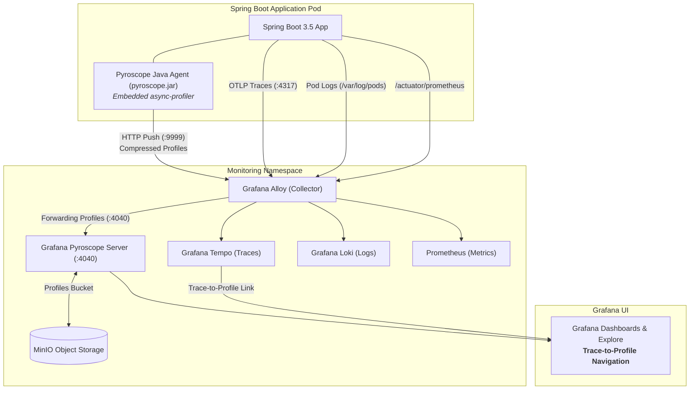

# 🔥 Continuous Profiling with Grafana Pyroscope & Spring Boot

This guide explains the concepts, architecture, and step-by-step implementation for integrating **Grafana Pyroscope** with our Spring Boot application and Grafana LGTM stack to enable **Continuous Profiling**.

---

## 🎯 What is Continuous Profiling?

Traditional observability relies on the **Three Pillars**:
* **Metrics (Prometheus):** Reveals *that* a symptom is happening (e.g., CPU is at 95% or heap memory is full).
* **Traces (Tempo):** Reveals *where* in a distributed call flow latency is accumulated (e.g., call spent 800ms inside database repository).
* **Logs (Loki):** Captures discrete events and errors (e.g., *TimeoutException*).

### The Missing Gap: *Code-Level Execution*
Metrics and traces identify that a service is slow or burning CPU, but cannot pinpoint **which method, loop, or class constructor** is responsible.

**Continuous Profiling** acts as the **"Fourth Pillar"** of observability. It continuously takes low-overhead (< 1-2% overhead) samples of running threads in production to generate **Flame Graphs** showing:
1. **CPU Usage:** Exact methods and lines of code executing on CPU cycles.
2. **Memory Allocation:** Classes and code paths allocating the most memory on the heap (diagnosing GC pressure).
3. **Lock / Wall-Clock Contention:** Threads blocked waiting for synchronizations or thread-pool locks.

---

## 🏗️ Architecture: The LGTMP Stack

With Pyroscope added, the stack evolves from **LGTM** (Loki, Grafana, Tempo, Mimir/Prometheus) to **LGTMP** (+ Pyroscope).



---

## 🔗 The Killer Feature: Span-to-Profile Correlation

When the Pyroscope Java Agent runs alongside OpenTelemetry / Micrometer Tracing:
1. Every time a span is active in Spring Boot, the agent automatically captures the active `trace_id` and `span_id`.
2. Stack trace samples are tagged with these trace identifiers.
3. In Grafana:
   - You inspect a slow trace in **Tempo**.
   - A **"Profiles for this span"** button appears directly inside the Tempo trace view.
   - Clicking it opens the **Pyroscope Flame Graph filtered specifically to the code executed during that request**!

---

## 🚀 Implementation Details

### 1. Agent Packaging via Jib & Maven (`pom.xml`)
The `pyroscope.jar` agent is automatically downloaded from Maven Central via `maven-dependency-plugin` and injected into the container image using Jib's `extraDirectories`:

```xml
<extraDirectories>
  <paths>
    <path>
      <from>${project.build.directory}/agents</from>
      <into>/opt/pyroscope</into>
    </path>
  </paths>
</extraDirectories>
```

### 2. Runtime Configuration via `JAVA_TOOL_OPTIONS` (`deployment/dev/app.yaml` & `deployment/prod/app.yaml`)
Attaching the agent via `JAVA_TOOL_OPTIONS` allows enabling or disabling profiling per-environment without rebuilding the container:

```yaml
env:
  - name: SPRING_APPLICATION_NAME
    value: "spring-boot-app"
  - name: JAVA_TOOL_OPTIONS
    value: "-javaagent:/opt/pyroscope/pyroscope.jar"
  - name: PYROSCOPE_APPLICATION_NAME
    value: "$(SPRING_APPLICATION_NAME)"  # Dynamically references Spring app name
  - name: PYROSCOPE_SERVER_ADDRESS
    value: "http://alloy.monitoring.svc.cluster.local:9999"
  - name: PYROSCOPE_PROFILER_EVENT
    value: "itimer"
```

---

## ⚙️ Understanding `PYROSCOPE_PROFILER_EVENT` & Event Types

The Pyroscope Java Agent delegates low-level stack collection to **`async-profiler`**. The `PYROSCOPE_PROFILER_EVENT` environment variable dictates **what event or signal triggers a profile sample**:

| Event Value | What It Measures | How It Works Under the Hood | When to Use / Recommendation |
| :--- | :--- | :--- | :--- |
| **`itimer`** *(Default / Recommended for Containers)* | **CPU Execution Time** | Uses POSIX process interval timer (`setitimer(ITIMER_PROF)`). Periodically sends signals to threads executing on the CPU. | ✅ **Best for Kubernetes / Docker containers.** Does not require root privileges or Linux `perf_events` subsystem permissions. Low overhead (< 1%). |
| **`cpu`** | **Hardware CPU Cycles** | Uses the Linux kernel `perf_events` subsystem (`perf_event_open`). Measures real CPU hardware performance counter ticks. | ⚠️ **Most accurate CPU measurement, but requires K8s capabilities:** Pod needs `securityContext.capabilities: [SYS_ADMIN]` or host `/proc/sys/kernel/perf_event_paranoid <= 1`. Fails in unprivileged container environments. |
| **`wall`** | **Wall-Clock Time (On-CPU + Off-CPU)** | Samples all threads regardless of whether they are executing on a CPU, sleeping, or waiting for network/disk I/O. | 🔍 **Use for diagnosing I/O latency:** Useful when a thread is taking 5 seconds waiting for a slow REST API, MongoDB socket read, or lock synchronization rather than burning CPU. |
| **`alloc`** | **Memory Allocation Rate** | Intercepts JVM TLAB (Thread-Local Allocation Buffer) and slow-path allocations. Measures *bytes or instances allocated over time*. | 🧠 **Use for GC pressure & memory leaks:** Shows which classes and methods create the most heap garbage over time (distinct from heap dumps which only show what's currently in memory). |
| **`lock`** | **Thread Lock Contention** | Measures the time threads spend blocked waiting on `synchronized` blocks or `java.util.concurrent.locks.ReentrantLock`. | 🔒 **Use for thread contention & deadlocks:** Pinpoints high-contention synchronized methods or exhausted connection pools. |

> **💡 Can You Profile Multiple Events at Once?**
>
> Yes! While `PYROSCOPE_PROFILER_EVENT` defines the primary engine (e.g. `itimer`), you can simultaneously capture memory allocations and lock contention by adding:
> ```yaml
> - name: PYROSCOPE_PROFILER_ALLOC
>   value: "512k"   # Sample memory allocation every 512KB allocated
> - name: PYROSCOPE_PROFILER_LOCK
>   value: "10ms"   # Sample lock contention waiting longer than 10ms
> ```
> This gives you CPU Flame Graphs, Memory Allocation Flame Graphs, and Lock Contention Flame Graphs in Grafana simultaneously!

### 3. Alloy Profiling Pipeline (`values-alloy.yaml`)
Grafana Alloy ingests profiles on port `9999` using `pyroscope.receive_http` and forwards them upstream to Pyroscope on port `4040` using `pyroscope.write`:

```river
// --- PROFILES: PYROSCOPE INGESTION & FORWARDING ---
pyroscope.receive_http "default" {
  http {
    listen_address = "0.0.0.0"
    listen_port    = 9999
  }
  forward_to = [pyroscope.write.local.receiver]
}

pyroscope.write "local" {
  endpoint {
    url = "http://pyroscope.monitoring.svc.cluster.local:4040"
  }
}
```

### 4. Grafana Datasource Configuration (`deployment/common/datasources/datasources.yaml`)
Add Pyroscope as a datasource and link Tempo traces to Pyroscope profiles:

```yaml
  - name: Pyroscope
    type: pyroscope
    uid: pyroscope
    url: http://pyroscope.monitoring.svc:4040

  - name: Tempo
    type: tempo
    uid: tempo
    url: http://tempo-query-frontend.monitoring.svc:3200
    jsonData:
      # Trace to Profiles linking
      tracesToProfiles:
        datasourceUid: 'pyroscope'
        tags:
          - key: 'service.name'
            value: 'service_name'
        profileTypeId: 'process_cpu:cpu:nanoseconds'
```

### 5. Pyroscope Helm Deployment (`Taskfile.yml`)
Deploy Pyroscope (Chart `v2.4.0`) in single-binary mode for sandbox / dev using the official Helm chart:

```powershell
task pyroscope
```
