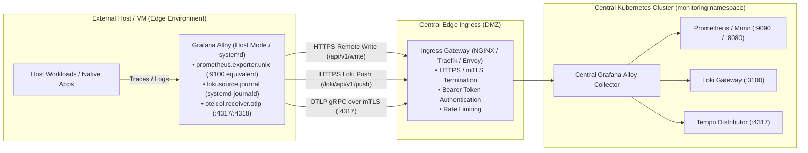

# 🖥️ External Virtual Machine (VM) Monitoring Guide

This guide outlines the architecture and deployment pattern for integrating external bare-metal servers and cloud Virtual Machines (VMs) outside Kubernetes into our central **Grafana LGTM stack** (Alloy, Prometheus/Mimir, Loki, Tempo, Grafana).

---

## 🏗️ 1. Architecture: Edge Push Model

Rather than having the Kubernetes cluster reach into private networks or across WANs to pull metrics from port `9100`, external VMs run an edge collector (**Grafana Alloy in host mode**) that **pushes telemetry outbound** to the central monitoring ingress gateway via secure HTTPS.



---

## 🚀 2. Deploying Grafana Alloy on Linux VMs

### A. Installation via Package Manager
On Debian / Ubuntu:
```bash
# Add Grafana GPG key
sudo mkdir -p /etc/apt/keyrings/
wget -q -O - https://apt.grafana.com/gpg.key | gpg --dearmor | sudo tee /etc/apt/keyrings/grafana.gpg > /dev/null

# Add Grafana repository
echo "deb [signed-by=/etc/apt/keyrings/grafana.gpg] https://apt.grafana.com stable main" | sudo tee /etc/apt/sources.list.d/grafana.list

# Install Alloy
sudo apt update
sudo apt install -y alloy
```

On RHEL / Rocky Linux:
```bash
sudo tee /etc/yum.repos.d/grafana.repo <<EOF
[grafana]
name=grafana
baseurl=https://rpm.grafana.com
repo_gpgcheck=1
enabled=1
gpgcheck=1
gpgkey=https://rpm.grafana.com/gpg.key
sslverify=1
sslcacert=/etc/pki/tls/certs/ca-bundle.crt
EOF

sudo dnf install -y alloy
```

---

## 📝 3. VM Alloy Configuration (`/etc/alloy/config.alloy`)

Place the following configuration in `/etc/alloy/config.alloy`:

```alloy
// =============================================================================
// 1. HOST METRICS (Node Exporter equivalent)
// =============================================================================
prometheus.exporter.unix "node_metrics" {
  procfs_path = "/proc"
  sysfs_path  = "/sys"
}

prometheus.scrape "host" {
  targets         = prometheus.exporter.unix.node_metrics.targets
  forward_to      = [prometheus.remote_write.central_gateway.receiver]
  scrape_interval = "15s"
}

// =============================================================================
// 2. REMOTE WRITE TO CENTRAL GATEWAY (HTTPS + Bearer Token)
// =============================================================================
prometheus.remote_write "central_gateway" {
  endpoint {
    url = "https://monitoring-gateway.example.com/api/v1/write"
    
    authorization {
      type        = "Bearer"
      credentials = sys.env("ALLOY_GATEWAY_TOKEN")
    }
    
    tls_config {
      ca_file = "/etc/alloy/certs/ca.crt"
    }
    
    send_exemplars = true
  }

  // Label every sample with host metadata for dashboard filtering
  external_labels = {
    environment = "on-prem-dc",
    host_type   = "virtual-machine",
    instance    = sys.env("HOSTNAME"),
  }
}

// =============================================================================
// 3. SYSTEM LOGS (systemd journald)
// =============================================================================
loki.source.journal "systemd_journal" {
  forward_to    = [loki.write.central_gateway.receiver]
  relabel_rules = discovery.relabel.journal_labels.rules
  labels        = {
    environment = "on-prem-dc",
    host_type   = "virtual-machine",
    instance    = sys.env("HOSTNAME"),
  }
}

discovery.relabel "journal_labels" {
  targets = []
  rule {
    source_labels = ["__journal__systemd_unit"]
    target_label  = "unit"
  }
  rule {
    source_labels = ["__journal_priority"]
    target_label  = "priority"
  }
}

loki.write "central_gateway" {
  endpoint {
    url = "https://monitoring-gateway.example.com/loki/api/v1/push"
    authorization {
      type        = "Bearer"
      credentials = sys.env("ALLOY_GATEWAY_TOKEN")
    }
    tls_config {
      ca_file = "/etc/alloy/certs/ca.crt"
    }
  }
}

// =============================================================================
// 4. LOCAL OTLP INGESTION FOR NATIVE HOST WORKLOADS
// =============================================================================
otelcol.receiver.otlp "default" {
  grpc { endpoint = "127.0.0.1:4317" }
  http { endpoint = "127.0.0.1:4318" }

  output {
    traces = [otelcol.exporter.otlp.central_tempo.input]
  }
}

otelcol.exporter.otlp "central_tempo" {
  client {
    endpoint = "monitoring-gateway.example.com:443"
    auth     = otelcol.auth.bearer.central_auth.handler
    tls {
      ca_file = "/etc/alloy/certs/ca.crt"
    }
  }
}

otelcol.auth.bearer "central_auth" {
  token = sys.env("ALLOY_GATEWAY_TOKEN")
}
```

---

## 🔒 4. Security & Environment Configuration

Set up environment variables and systemd permissions:
```bash
# Store gateway token securely
sudo mkdir -p /etc/alloy/certs
sudo chmod 700 /etc/alloy

echo "ALLOY_GATEWAY_TOKEN=super-secret-token" | sudo tee /etc/default/alloy
sudo chmod 600 /etc/default/alloy

# Start and enable the service
sudo systemctl daemon-reload
sudo systemctl enable --now alloy
sudo systemctl status alloy
```

---

## 📊 5. Standard VM USE Alerting Rules

These rules evaluate on Prometheus/Mimir for all external VMs:

| Alert Name | Expression (PromQL) | Threshold | Severity |
| :--- | :--- | :--- | :--- |
| **`VmHostDown`** | `up{host_type="virtual-machine"} == 0` | for 2m | `critical` |
| **`VmCpuSaturation`** | `100 - (avg by (instance) (rate(node_cpu_seconds_total{mode="idle"}[5m])) * 100) > 90` | for 5m | `warning` |
| **`VmMemoryExhaustion`** | `(1 - (node_memory_MemAvailable_bytes / node_memory_MemTotal_bytes)) * 100 > 90` | for 5m | `critical` |
| **`VmDiskFullPredictive`** | `predict_linear(node_filesystem_free_bytes{mountpoint="/"}[4h], 4 * 3600) < 0` | for 30m | `critical` |
| **`VmInodeExhaustion`** | `(1 - (node_filesystem_files_free / node_filesystem_files)) * 100 > 90` | for 5m | `critical` |
| **`VmNetworkPacketDrops`** | `rate(node_network_receive_drop_total[5m]) + rate(node_network_transmit_drop_total[5m]) > 10` | for 5m | `warning` |
